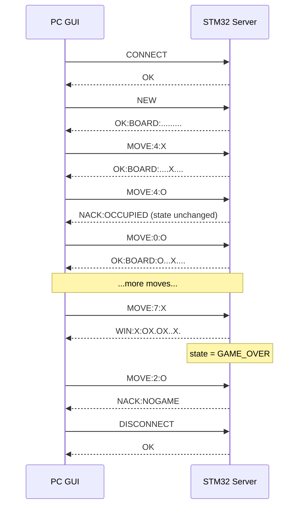

# Serial Game Server: Message Protocol (v1.0)

Game: Tic-Tac-Toe. The STM32 is the authoritative server; the PC GUI is a thin client.
This file is the single source of truth for the firmware, GUI, tests and report (deliverable A.2, report section 2).

---

## 1. Link layer

| Item | Value |
|---|---|
| Physical link | UART over the board's on-board virtual COM port (ST-LINK VCP). Confirm which USART your board routes to it. |
| Settings | 115200 baud, 8 data bits, no parity, 1 stop bit (8N1), no flow control |
| Encoding | ASCII, case-sensitive, commands are UPPERCASE |
| Direction | Client sends requests, server sends exactly one response line per request |

## 2. Framing

- Every message (both directions) is one line ending in `\n` (0x0A).
- The server strips one trailing `\r` before the `\n`, so terminals that send `\r\n` still work.
- **Maximum frame length: 32 bytes including the terminator** (so at most 31 payload characters).
- **Overflow:** if 32 bytes arrive with no `\n`, the server discards everything until the next `\n`, then replies `NACK:BADCMD`. Nothing is parsed from the discarded data.
- **Timeout:** if a partial frame is pending and no byte arrives for **500 ms**, the server clears the buffer and replies `NACK:TIMEOUT`.
- **Empty line** (just `\n`) gets `NACK:BADCMD`.
- **Non-ASCII / control bytes** (anything outside 0x20-0x7E apart from the terminator) make the whole frame invalid: `NACK:BADCMD`.
- The server never blocks waiting for input. Reception is interrupt-driven (or polled) into a ring buffer, and the main loop parses complete frames.
- **Checksum (optional, not in v1.0):** a possible extension is `payload*HH`, where HH is the XOR of all payload bytes as two uppercase hex digits. A frame with a bad checksum would get `NACK:BADCMD`. If implemented, document it as a departure.

## 3. Board encoding

- Nine characters, indices 0-8, row-major:

```
0 1 2
3 4 5
6 7 8
```

- `.` = empty, `X` = player X, `O` = player O.
- Example: `XO..X...O` is
```
X O .
. X .
. . O
```
- **X always moves first.** Turns alternate X, O, X, O...
- The current turn is derived from the board (count of X vs O), so no turn field is needed in messages.

## 4. Commands (client to server)

| Command | Meaning |
|---|---|
| `CONNECT` | Start a session |
| `NEW` | Start a new game |
| `MOVE:<i>:<P>` | Player `<P>` (`X` or `O`) plays cell `<i>` (0-8) |
| `STATE` | Ask for the current board |
| `RESIGN` | Forfeit the current game |
| `DISCONNECT` | End the session |

`<i>` must be one or more decimal digits (no sign, no spaces). `<P>` must be exactly `X` or `O`.
Anything that does not match a command above exactly is `NACK:BADCMD`.

## 5. Responses (server to client)

| Response | Meaning |
|---|---|
| `OK` | CONNECT or DISCONNECT accepted |
| `OK:BOARD:<9 chars>` | NEW accepted, or MOVE accepted and the game continues. The board is the confirmed state. |
| `WIN:X:<9 chars>` / `WIN:O:<9 chars>` | The move won the game. Board included so the GUI can draw it. |
| `DRAW:<9 chars>` | The move filled the board with no winner. Board included. |
| `BOARD:<9 chars>` | Reply to STATE |
| `OK:GAMEOVER` | RESIGN accepted |
| `NACK:<reason>` | Request rejected, **game state unchanged** (see section 7) |

Unsolicited line (optional): `EVT:RESET` is sent when the on-board button resets the server (section 9). Clients must handle it; test scripts should ignore lines starting `EVT:`.

## 6. State machine and command matrix

States: **IDLE** (boot and after DISCONNECT/reset), **IN_PROGRESS**, **GAME_OVER**.

| Command | IDLE | IN_PROGRESS | GAME_OVER |
|---|---|---|---|
| `CONNECT` | `OK` | `OK` (no change) | `OK` (no change) |
| `NEW` | `OK:BOARD:.........` then IN_PROGRESS | `NACK:BADSTATE` | `OK:BOARD:.........` then IN_PROGRESS |
| `MOVE:i:P` | `NACK:NOGAME` | validate (section 7); legal move gives OK / WIN / DRAW | `NACK:NOGAME` |
| `STATE` | `NACK:NOGAME` | `BOARD:<9>` | `BOARD:<9>` |
| `RESIGN` | `NACK:NOGAME` | `OK:GAMEOVER` then GAME_OVER | `NACK:NOGAME` |
| `DISCONNECT` | `OK` | `NACK:BADSTATE` (resign first) | `OK` then IDLE |
| anything else | `NACK:BADCMD` | `NACK:BADCMD` | `NACK:BADCMD` |

Transitions on MOVE (IN_PROGRESS only): legal non-terminal gives stay IN_PROGRESS; WIN or DRAW gives GAME_OVER.

## 7. MOVE validation (fixed order, stop at first failure)

1. **State:** if not IN_PROGRESS, `NACK:NOGAME`.
2. **Parse:** if the format is not `MOVE:<digits>:<X|O>`, `NACK:BADCMD`.
3. **Range:** if `i` is not in 0..8, `NACK:RANGE`.
4. **Occupied:** if `board[i] != '.'`, `NACK:OCCUPIED`.
5. **Turn:** if `P` is not the player whose turn it is, `NACK:NOTURN`.
6. **Commit:** only now write `board[i] = P`, then check win/draw and update state.

Rule: **steps 1-5 only read state; step 6 is the only place state is written.** A rejected request therefore cannot change the board, turn or status. This is the argument for report section 5.

Win check: the 8 lines `012 345 678 036 147 258 048 246`; a line wins if all three cells are the same non-`.` mark. Draw: no win and no `.` cells remain. Win is checked before draw (a final move that completes a line is a win, not a draw).

## 8. Error codes

| Error | Cause |
|---|---|
| `NACK:BADCMD` | Unknown command, bad format, bad player letter, non-ASCII bytes, empty line, oversize frame |
| `NACK:TIMEOUT` | Partial frame abandoned after 500 ms |
| `NACK:NOGAME` | Command needs a running game but state is IDLE or GAME_OVER (MOVE, STATE in IDLE, RESIGN) |
| `NACK:BADSTATE` | Valid command not allowed in the current state (NEW mid-game, DISCONNECT mid-game) |
| `NACK:RANGE` | Cell index outside 0-8 |
| `NACK:OCCUPIED` | Cell already taken |
| `NACK:NOTURN` | It is the other player's turn |

## 9. Hardware behaviour (on-board button and LED)

- **Button (user button, debounced about 50 ms):** forces a reset to IDLE with an empty board and sends `EVT:RESET`.
- **LED:**
  - IDLE: off
  - IN_PROGRESS, X to move: solid on
  - IN_PROGRESS, O to move: off
  - GAME_OVER: blinks at 2 Hz (non-blocking, driven by `HAL_GetTick()`)

## 10. Departures from the reference brief (justify in report section 2)

| Reference | This protocol | Why |
|---|---|---|
| `MOVE:<index>` | `MOVE:<index>:<X\|O>` | With a single client the server alone would pick the player, so `NACK:NOTURN` could never occur or be tested. The explicit player makes out-of-turn requests possible and the server still decides legality. |
| `WIN:X` / `DRAW` | `WIN:X:<9>` / `DRAW:<9>` | The GUI redraws only from valid server responses, so the terminal response must carry the final board. |
| (none) | `NACK:BADSTATE` | Distinguishes "command exists but not now" from "no game exists". |
| (none) | `NACK:TIMEOUT` | Explicit, testable recovery from partial frames. |
| (none) | `EVT:RESET` | Lets the GUI notice a button reset instead of going stale. |

## 11. Example sessions

Normal game (client lines start `>`, server lines start `<`):

```
> CONNECT
< OK
> NEW
< OK:BOARD:.........
> MOVE:4:X
< OK:BOARD:....X....
> MOVE:4:O
< NACK:OCCUPIED
> MOVE:9:O
< NACK:RANGE
> MOVE:0:X
< NACK:NOTURN
> MOVE:0:O
< OK:BOARD:O...X....
> MOVE:1:X
< OK:BOARD:OX..X....
> MOVE:3:O
< OK:BOARD:OX.OX....
> MOVE:7:X
< WIN:X:OX.OX..X.
> MOVE:2:O
< NACK:NOGAME
> DISCONNECT
< OK
```

Garbage and recovery:

```
> HELLO
< NACK:BADCMD
> MOVE:abc:X
< NACK:BADCMD            (when IN_PROGRESS; NACK:NOGAME otherwise)
> MOVE:4                 (then 500 ms of silence, no newline)
< NACK:TIMEOUT
> STATE
< BOARD:.........
```

## 12. Sequence diagram



## 13. Required tests mapped to this protocol

| Brief requirement | Test sends | Expects |
|---|---|---|
| CONNECT returns OK | `CONNECT` | `OK` |
| NEW returns empty board | `NEW` | `OK:BOARD:.........` |
| Legal move changes board | `MOVE:4:X` | `OK:BOARD:....X....` |
| Occupied unchanged | `MOVE:4:X`, `MOVE:4:O`, `STATE` | `NACK:OCCUPIED`, then `BOARD:....X....` |
| Out of range | `MOVE:9:X` | `NACK:RANGE` |
| Out of turn | `MOVE:0:O` as first move | `NACK:NOTURN` |
| Move after game over | win sequence, then `MOVE:..` | `NACK:NOGAME` |
| Scripted win | X: 0,1,2 with O: 3,4 | `WIN:X:XXXOO....` |
| Scripted draw | a full-board no-win sequence | `DRAW:<9>` |
| Robustness | garbage, oversize, partial | `NACK:BADCMD` / `NACK:TIMEOUT`, state intact |
