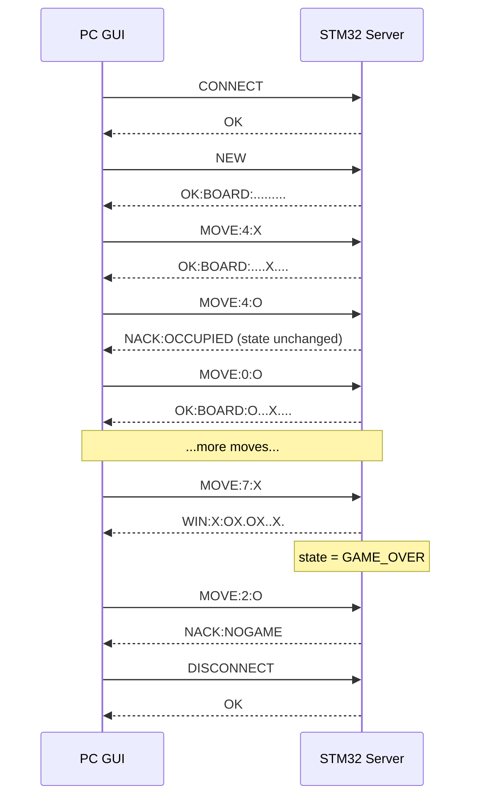

# Message Protocol Description

Game: Tic-Tac-Toe. The STM32 server is authoritative; the PC GUI is a thin client.
Link: UART (ST-LINK virtual COM port), 115200 baud, 8N1.

## 1. Message framing

- Messages are ASCII text, one per line, terminated by `\n`. The server also accepts `\r\n` (it strips a trailing `\r`).
- Maximum frame length is 32 bytes including the terminator.
- If 32 bytes arrive with no `\n`, the server discards input up to the next `\n` and replies `NACK:BADCMD`.
- If a partial frame is pending and no byte arrives for 500 ms, the server discards it and replies `NACK:TIMEOUT`.
- Empty lines and frames containing non-printable or non-ASCII bytes get `NACK:BADCMD`.
- Every request gets exactly one response line.

## 2. Board encoding

Nine characters, indices 0-8, row-major (`0 1 2 / 3 4 5 / 6 7 8`):

- `.` empty, `X` player X, `O` player O
- Example: `XO..X...O`
- X always moves first, then turns alternate.

## 3. Commands (client to server)

| Command | Meaning |
|---|---|
| `CONNECT` | Establish a session |
| `NEW` | Start a new game |
| `MOVE:<i>:
` | Player `
` (`X` or `O`) plays cell `<i>` (0-8) |
| `STATE` | Request the current board |
| `RESIGN` | Forfeit the current game |
| `DISCONNECT` | End the session |

Anything else is rejected with `NACK:BADCMD`.

## 4. Responses (server to client)

| Response | Sent when |
|---|---|
| `OK` | `CONNECT` or `DISCONNECT` accepted |
| `OK:BOARD:<9 chars>` | `NEW` accepted (empty board), or `MOVE` accepted and the game continues |
| `WIN:X:<9 chars>` / `WIN:O:<9 chars>` | The move completed a line of three; final board included |
| `DRAW:<9 chars>` | The move filled the board with no winner; final board included |
| `BOARD:<9 chars>` | Reply to `STATE` |
| `OK:GAMEOVER` | `RESIGN` accepted |
| `EVT:RESET` | Unsolicited: the on-board button reset the server to IDLE |

## 5. Errors

Every `NACK` leaves the game state unchanged.

| Error | Cause |
|---|---|
| `NACK:BADCMD` | Unknown command, bad format, bad player letter, empty line, invalid bytes, oversize frame |
| `NACK:TIMEOUT` | Partial frame abandoned after 500 ms |
| `NACK:NOGAME` | Command needs a running game, but there is none (`MOVE`, `RESIGN`, or `STATE` in IDLE; `MOVE` in GAME_OVER; `RESIGN` in GAME_OVER) |
| `NACK:BADSTATE` | Valid command not allowed now (`NEW` or `DISCONNECT` during a game) |
| `NACK:RANGE` | Cell index outside 0-8 |
| `NACK:OCCUPIED` | Cell already taken |
| `NACK:NOTURN` | It is the other player's turn |

`MOVE` checks run in this order and stop at the first failure: game running, format, range, occupied, turn. Only a move that passes all checks changes the board.

## 6. Behaviour by server state

| Command | IDLE | IN_PROGRESS | GAME_OVER |
|---|---|---|---|
| `CONNECT` | `OK` | `OK` | `OK` |
| `NEW` | `OK:BOARD:.........`, go to IN_PROGRESS | `NACK:BADSTATE` | `OK:BOARD:.........`, go to IN_PROGRESS |
| `MOVE:i:P` | `NACK:NOGAME` | validate; reply `OK:BOARD`, `WIN` or `DRAW` | `NACK:NOGAME` |
| `STATE` | `NACK:NOGAME` | `BOARD:<9>` | `BOARD:<9>` |
| `RESIGN` | `NACK:NOGAME` | `OK:GAMEOVER`, go to GAME_OVER | `NACK:NOGAME` |
| `DISCONNECT` | `OK` | `NACK:BADSTATE` | `OK`, go to IDLE |

A `WIN` or `DRAW` reply moves the server to GAME_OVER.

## 7. Sequence diagram

